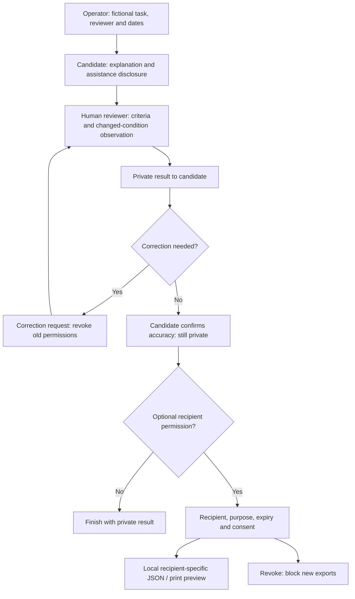
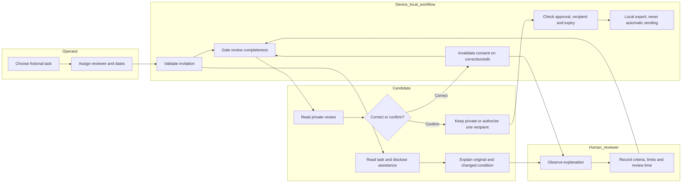

# UMBRAL - Week 9 Business Bending Packet

Rodrigo Peña León - OPERATOR - 7 October 2026

## 1. Decision and evidence status

The supplied Team 2 Blueprint selects FIRST-PROOF as its primary vacuum. This individual build implements the OPERATOR declaration: intake-to-review workflow with scope, reviewer, deadlines and consent. The source remains a draft synthesis of four role briefs, with proposed bets and a pending TECHNOLOGIST declaration. Starting this build is Rodrigo's instruction; it does not establish a completed five-person vote, live Team session, employer commitment or real pilot result.

The personal Brain brief remains Rodrigo's final individual brief and preserves his preference for paid Micro-experience. This build follows the supplied Blueprint's First-Proof direction while retaining that dissent: a verified simulation may fail to create income, and employer task supply/reviewer capacity may make the model uneconomic.

This Packet was saved before product-source code. Any later scope change must be dated here.

## 2. Exact user and failed moment

Primary user: a coordinator at a Mexican university career office or small-business network. Failed moment: a candidate with informal bookkeeping experience cannot show a credible, bounded sample, while the employer has no named reviewer, rubric, agreed review deadline or permission to use/share the evidence. These are hypotheses derived from the Blueprint, not interview findings from this build.

Secondary actors: the candidate who owns the evidence, and the named human reviewer who observes the explanation or live changed-condition exercise and records feedback. The coordinator owns delivery, not an employability verdict.

## 3. Product and selected slice

Umbral is a controlled workflow for one fictional bookkeeping work sample. It demonstrates ability in the bounded task; it is not a universal certificate. The first viewport is an operator work queue with session states, review deadlines and a create-invitation action.

Included: invitation with bounded scope and fictional/public data; named reviewer and deadlines; candidate assistance disclosure; observed changed condition; criterion-by-criterion human review; candidate-first result; correction request and reviewer response; private approval; individual recipient authorization and revocation; local export; audit trail; review-time measurement; pilot decision thresholds.

Excluded: CV builder, job board, ranking, automatic rejection, universal score, real production work, candidate fees, credential verification, identity guarantee and claims of hiring. The demo has a role switch for exploring fictional records, not real multi-user authentication. Do not enter personal/client data. Local persistence is explicitly limited to this demonstration on this device. Production needs authenticated actor isolation, retention/deletion policy, a real consent service and institutional review before real participants.

## 4. One coherent workflow

1. Operator chooses the verified fictional template, names the reviewer, sets due dates and confirms task scope/review conditions.
2. Candidate sees the task, rubric, data and assistance policy before accepting. An accessible written explanation alternative is available.
3. Candidate submits an explanation and discloses AI assistance. The reviewer observes a live revision/explanation of the changed condition.
4. Reviewer records evidence per criterion, observation method, feedback and review time. No automatic rating/ranking. Incomplete observation blocks a shareable proof.
5. Result returns privately to the candidate. They can request correction, keep it private, remove their local attempt or approve the accurate record.
6. Candidate authorizes a named recipient for a stated purpose, then exports a recipient-specific proof. Authorization can be revoked locally; already downloaded copies cannot be recalled. Never imply otherwise.

State rules: invited -> submitted -> reviewed_private -> correction_requested -> reviewed_private -> approved_private -> authorized. A private incomplete attempt may be revised or deleted; it is not exported as a permanent failure label. A reviewer must resolve a correction before candidate approval/sharing. An edit to a reviewed record invalidates prior approval and sharing. A proof always carries fictional-demo labeling.

## 5. Dragon Stack

LLM: a server-side Gemini 3.5 Flash-Lite drafting assistant for routine wording of scope and accommodation, grounded in the selected template and its four human-review criteria. It must not evaluate a candidate, rank, reject, verify identity or infer employability. The provider key is stored as a masked server secret. Actual live drafting was verified on 7 October 2026. If the provider is unavailable, show that status and let the verified template workflow continue; never label the deterministic fallback as LLM output. The operator must review generated wording before creating an invitation.

Structured/verified data: versioned template JSON, explicit criterion definitions, synthetic ledger rows, a manually checked reference calculation, provenance, allowed state transitions and consent/event records. These data establish the fictional exercise arithmetic, not actual skill or demand.

Additional component: deterministic workflow/consent guardrails, deadline/review timer and portable recipient-specific evidence export. The browser performs these functions independently of a model.

Implementation: semantic HTML/CSS and browser ES modules; a minimal Cloudflare-compatible Worker for the drafting endpoint; no external browser trackers. Model requests contain only a selected fictional task and closed-list drafting context, never candidate answers or names. Demo records remain on the device.

## 6. Template and human verification

Fictional task: reconcile a small shop's cash drawer. Opening cash MXN 500 + cash sales 1,890 - cash refund 120 - cash expenses 250 - bank deposit 1,000 = closing cash MXN 1,020. Changed condition: the refund was paid by card, not cash; corrected closing cash = MXN 1,140. Reference amounts support reviewer preparation; they never issue a candidate score.

Criteria: trace each cash movement; identify missing/contradictory evidence; explain the changed-condition adjustment; state assumptions and AI assistance. Reviewer records observed/support-needed/not-observed for each criterion, a factual note and an explanation of limits. No weighted total. The proof names reviewer, task version, observation method, revision, assistance and date.

Benchmark: Riipen's institution/employer project scoping, matching and feedback workflow is the closest operating reference; Forage shows bounded simulations, sample tasks and model answers. Umbral's localization bet is Spanish-first, informal-experience recognition, short named-human review and candidate-controlled sharing. This does not establish employer preference over an existing work-sample test. Official references checked for the implementation: https://www.riipen.com/educators and https://www.theforage.com/.

## 7. Shadow clause and acceptance checks

No unpaid production work. The fictional assessment cannot be repurposed as a client deliverable. Any later real-work branch requires agreed pay, scope, supervision, acceptance rules and applicable labor protections. No permanent failure label or public unsuccessful attempt. Candidate sees results first and controls every recipient. Accessibility accommodations must preserve the capability observed rather than reward polished presentation.

Acceptance: cannot invite without reviewer/deadlines/scope confirmation; cannot submit without assistance disclosure; cannot finish review without each criterion and observed revision/explanation; cannot approve unresolved correction; cannot export proof without candidate approval and named-recipient authorization; revocation disables future recipient export; substantive review edits invalidate prior sharing; deletion removes the local record; recover gracefully if browser storage or AI is unavailable; keyboard/mobile usable.

## 8. Mechanical and persona checks

Test the high-consequence state/consent guards and the known arithmetic. Exercise the actual browser flow at desktop/mobile, including one correction and one revocation. Record any observed defect, correction and subsequent deployment honestly; do not manufacture a defect or deployment history. Use a clearly labeled synthetic persona for comprehension and privacy checks, with captures from the actual app, and separate those results from real user validation.

Proposed pilot: 3 businesses, 12 candidates, not achieved. Stop/redesign if fewer than 2/3 employers would pay to repeat, median review exceeds 10 minutes, or comparison against final-artifact-only evidence reveals no useful additional hiring information. Demo fixtures do not count toward those targets. Money owns real willingness-to-pay research; this operator slice only makes delivery observable.

## 9. Three-year vision and next evidence

If a bounded sample changes actual employer decisions and reviewer costs stay manageable, Umbral could become a small institutional evidence service with reusable task families and interoperable candidate-owned proof. It would need authenticated privacy, reviewer calibration, retention controls, accessible observation, payment/repeat-purchase evidence and local partner capacity. Do not build a marketplace before that evidence.

Next evidence: compare proof versus final artifact with actual employers; observe informal-experience candidates completing the task; measure reviewer minutes; test willingness to fund repeat assessments; review candidate comprehension of recipient-specific consent. Public GitHub delivery and live Gemini drafting are now verified. Team confirmation and original human recordings remain separate delivery items. The original visible build exchange is recovered locally during the audit.

## 10. Implementation update - 7 October 2026

The bounded operator workflow is implemented and two private publications succeeded. Existing regression checks passed 14/14 after a real malformed-restored-review defect was corrected. An actual fictional browser walkthrough exercised candidate-first review, separate permission, revocation and correction followed by new private confirmation. Manual demo timer inputs are not measured pilot results.

The first export path could not confirm a downloaded file in the integrated browser. It now exposes visible JSON with text selection and manual saving instructions, plus a printable proof in the current app. Native browser download and OS Save as PDF remain unverified. Actual captures and the synthetic-persona report document the limits.

The initial Gemini check reported a missing provider secret; that historical observation remains in the synthetic-persona report. Gemini was subsequently configured and two real drafts were observed as described below. Public access was enabled with Rodrigo's explicit authorization on 7 October and the actual application opened without a sign-in gate. Code and the original build history were uploaded to the public GitHub repository. Production authentication, actual videos, original build-chat export and real pilot validation are not claimed complete. Version 2 was published successfully from commit 77c26576b0d615550f7b78622e46389f13dda773 after the export refinement. Published URL: https://umbral-week9-rodrigo.j6x567qt8g.chatgpt.site.

### Public handoff - 7 October 2026

Rodrigo explicitly authorized public access and GitHub delivery. Sites access revision 2 confirms public mode. The published application was observed opening with the fictional operator workspace instead of the previous sign-in gate. The public GitHub repository was created at https://github.com/rodrigobuilds3-creator/umbral-week9. After Rodrigo completed GitHub's email verification, the original nine build commits were pushed intact to main. The public-delivery documentation extends that history. The original local history and source bundle remain preserved.

### Live Gemini update - 7 October 2026

Rodrigo authorized the dedicated Umbral Week 9 Google project and Gemini key. AI Studio showed Free tier; billing was not enabled. Sites environment revision 1 stores the key as a masked secret. The code uses Gemini 3.5 Flash-Lite for closed-template drafting, never candidate assessment.

Two actual published-app requests returned Gemini text. Codex's simulated operator review found that the first draft wrongly told the candidate to withhold the final number. The prompt was clarified so the candidate calculates and explains both cases while the assistant withholds the answers. A second live response correctly requested both balances, the four review criteria, and a written explanation followed by reviewer questions. Neither request sent a candidate name or answer; no invitation or human assessment was created from this check.

Five native publications have succeeded across four saved versions, including the secret activation and corrected-prompt publication. Version 4 uses source 5e3eae75098a547d7fae92b92d93059c7d137566. Full responses, the visible Gemini success message and exact deployment results are preserved in the evidence and logs. Automated regression results remain historical; no new suite run is claimed for the Gemini change.

## 15. Assignment audit addendum - 11 October 2026

Chronology: the core Packet was committed before code as c3a13ed on 7 October (Mexico City). The image-generated mockup, Mermaid diagrams, architecture table, explicit success statement and detailed commit plan were missing then. They are completed during the 8-11 October review and are NOT claimed to have existed before implementation. The assignment's full pre-code Packet requirement therefore retains a chronology limitation.

Success definition: before this module closes, one fictional cash task must work from an operator invitation with named reviewer/deadlines, through explanation and a simulated human review, to candidate-first correction/confirmation and separately authorized recipient-specific JSON/print preview. A malformed restored review must recover; private/unapproved/corrected/revoked/expired records must not generate an authorized proof. The published scope assistant must return a real Gemini draft and keep all candidate information outside model requests. This is a functional demonstration success criterion; it does not establish hiring, payment or observed human capability.

Exact benchmark line: The best existing operating reference on Earth for this institutional project-scoping/review workflow is Riipen. Our localization bet is Spanish-first recognition of informal experience, one short named-human task review, a written explanation alternative and recipient-specific candidate control in a Mexican university/small-business setting. Forage is the comparison for bounded simulations; neither benchmark proves that Umbral is preferred locally. The proposed local comparison can kill our product if an existing cash work-sample achieves the same information with less coordination cost.

### Architecture and stack table

| Component | Implementation | Input/output and limit |
|---|---|---|
| Browser UI | Semantic HTML/CSS and ES modules | Fictional alias, explanation and criterion notes; device-local persistence only |
| Structured data | Versioned TASK JSON and explicit transitions | Checked fictional ledger: 1,020 / 1,140; no universal skill score |
| Additional Dragon component | Consent workflow, review timer, recipient export | Approval and individual permission gates; local revocation; downloaded copies cannot be recalled |
| Server drafting | Cloudflare-compatible Worker on Sites | Closed task ID plus written accommodation; unexpected fields rejected |
| Real LLM | Gemini 3.5 Flash-Lite | Scope wording only; never sees candidate identity/answers or makes a verdict |
| Secret/config | Masked Sites server environment | No credential in source/client/archive; free tier observed, billing not activated |
| Hosting/source | Public Sites + public GitHub | Same authorized audience; reproducible source and meaningful deployment history |

Authentication/RLS condition: this demonstration prohibits real personal data and has no shared user database or Supabase tables. Its role selector is navigation, not identity control. No RLS protection is claimed. A real-person pilot requires authentication, actor isolation, retention controls and funded human review before collecting personal information.

### Mermaid flowchart (added after the build)

### Mermaid swimlane (actor responsibilities)

The image-generated design concept is stored in assets/umbral-imagegen-mockup-2026-10-08.png and labeled as a later mockup. It is not a production screenshot or evidence of real candidates.

### Recheck and remaining limits

The current source passed 14/14 automated domain/API tests during this audit, including mock-provider checks; historical real Gemini requests remain distinct evidence. A fresh Google AI Studio chat on 11 October reviewed six actual screenshots in order, identified confusion about accuracy confirmation versus sharing, and prompted an explicit optional/no-automatic-sending clarification. The full fresh response and a visual retest are retained with the Persona report.

The 3:30 DEMO uses actual app captures with disclosed synthetic narration. The independent two-minute camera reflection and Team FUSION are still original-human evidence requirements. The Brain raw process must be the actual personal research argument; a build conversation or simulated dialogue cannot replace it. DECISIONS.md is first created during this audit; its earlier history is explicitly reconstructed from commits rather than invented session notes.
